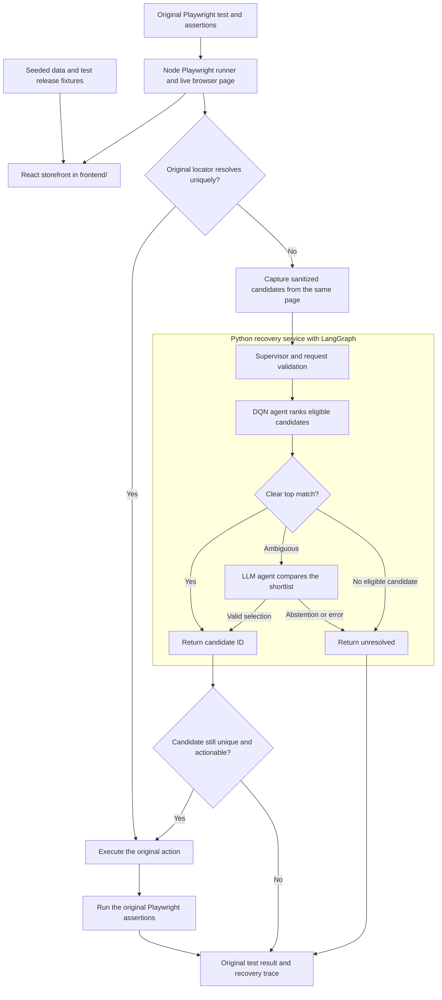

# Storefront and self-healing test design

## Goal and scope

Build a production-style electronics storefront in `frontend/` and demonstrate that an existing Playwright test can recover from a realistic UI release change while still detecting a product regression. Use seeded products, test accounts, and simulated checkout so the same scenarios can be replayed. The root npm scripts already target `frontend/`.

The first milestone covers Search from catalog to product detail. Cart, Checkout, Login, and Profile follow once Search recovery works end to end. The existing mutation benchmark and DQN checkpoint serve as the starting comparison.

## Storefront design

Give the store a consistent visual identity centered on desk and computer accessories. Use a warm neutral canvas, charcoal text, one cobalt accent for primary actions, Instrument Sans, and product photography on consistent backgrounds. Shared components cover navigation, buttons, fields, product cards, and status messages. Verify keyboard navigation, visible focus, accessible names, and layouts at desktop and mobile widths.

| Screen | Design and behavior |
| --- | --- |
| Catalog | Search, category controls, result count, and a responsive product grid. Include a clear no-results state and a way to reset filters. |
| Product detail | Product imagery, price, availability, specifications, and a prominent add-to-cart action. Make product identity visible in the heading and URL. |
| Cart and Checkout | Quantity controls, line items, order totals, editable delivery details, field validation, and a confirmation that identifies the order. |
| Login and Profile | Consistent field labels, inline validation, and visible success states for test accounts and profile updates. |

Gate the debug panel and mutation controls to the test environment. Use the Playwright report and a linked recovery trace as the first demo surface.

## Architecture

### Runtime contract

- **Playwright owns the browser and test outcome.** Add an opt-in wrapper for `click` and `fill` in `frontend/tests/playwright/`. Recovery starts on a missing or ambiguous locator before an action executes. Use Playwright’s normal waiting for transient rendering. When execution may already have occurred, surface the failure and preserve the trace.
- **Capture candidates from the live page.** Port or share the extraction rules in `rl/candidates/extractor.py` for the Node runner. Send a snapshot ID, the action type, the public step intent, a saved fingerprint of the original target, and candidate summaries with role, name, and nearby section context. Scope candidate IDs to the snapshot and keep their Playwright locator bindings in the runner. Keep input values, credentials, raw HTML, and evaluator labels out of the model payload.
- **Keep the Python service focused on ranking.** Use one local request per recovery event. Adapt the request to the existing DQN encoder and checkpoint shape, including its candidate mask and fixed candidate capacity. Verify feature parity on a captured fixture before trusting policy output. Tune the Q-value margin on validation cases. If a clear top candidate is unavailable, the LLM reviews a bounded shortlist and returns a candidate ID or abstains. Start with GPT-6.2 Sol and compare GPT-6 Luna on the same fixtures.
- **Validate before acting.** Check the returned ID belongs to the active snapshot, then resolve the corresponding locator and confirm it identifies one actionable element. Use the original action and input value. Allow at most one recovery attempt per step for the first milestone. A timeout, stale candidate, or abstention yields an unresolved test step. A failed business assertion remains a test failure.

## Delivery plan

| Milestone | Work | Exit check |
| --- | --- | --- |
| 1. Establish baseline | Run the existing `frontend` Search spec and record its assertions. Record the app version, viewport, seed, and policy version for future comparisons. | The baseline is reproducible from the root npm scripts and a seeded fixture. |
| 2. Build two storefront releases | Release A ships the redesigned catalog and detail pages and records the Search target fingerprint. Release B moves Search to the header, changes its control markup, and adds a plausible distractor such as search within a help panel. Keep product search behavior equivalent. | The Search journey works manually in both releases. The locator recorded on Release A fails on Release B. |
| 3. Integrate recovery | Connect the Playwright wrapper to a stub candidate ranker, then replace the stub with DQN and attach the LLM branch. Add negative fixtures for missing targets and genuine search regressions. | The same test passes on Release A, recovers on Release B, and fails for missing targets and incorrect search behavior. |
| 4. Add production regression coverage | Implement the case matrix below against seeded staging data. Run the original Playwright suite with recovery disabled as the CI gate and exercise recovery in a separate job. | Each case has a repeatable fixture, a business assertion, and an expected result on its applicable release and regression variants. |
| 5. Evaluate learning and transfer | Compare Playwright alone, heuristic, DQN, LLM, and DQN plus LLM. Collect verified recovery examples and evaluate any updated policy on held-out releases and an independently built test app. | Report recovery and false-pass rates by workflow and app, plus wrong actions, latency, and model cost. |

## Production-style regression cases

The existing suite covers successful Search and Profile updates, successful and invalid Login, successful Checkout, and empty-cart protection. Keep those cases and strengthen their assertions as the storefront gains behavior. Write the new tests around user-visible behavior, use role and label locators where practical, and isolate fixture data per test. A well-written locator that survives a redesign is a baseline pass. [Playwright best practices](https://playwright.dev/docs/best-practices)

| Case and fixture | User action | Required assertion | UI release change or regression to exercise |
| --- | --- | --- | --- |
| **Search: similar products**. Seed two similarly named mice with different SKUs. | Search for the wireless model and open its result. | The scoped result and detail page show the intended product name and SKU. | Move search into the header and add a help search. In the regression fixture, return the wrong SKU and require failure. |
| **Search: no results and reset**. Seed a catalog with no matching product. | Submit an unmatched query, then clear it. | The no-results state has zero product cards. Clearing restores the seeded catalog. | Replace the clear button with an icon that has an accessible name. Test a regression that keeps stale results. |
| **Cart: quantity and totals**. Seed a product at ₹1,299 with stock for two units. | Add it, set quantity to two, then remove it. | The correct SKU appears, the subtotal becomes ₹2,598, and removal restores the empty state and zero cart count. | Move quantity controls into a cart drawer. Test a regression that changes quantity without updating the subtotal. |
| **Checkout: successful order**. Seed one purchasable cart and a successful payment simulation. | Enter delivery details and submit once. | Confirmation identifies the order. The test order store contains exactly one order with the expected SKU, quantity, and total. The cart clears. | Move the submit button into a sticky summary. Test a regression that creates duplicate orders. |
| **Checkout: declined payment**. Seed a cart and a deterministic declined payment response. | Submit valid delivery details using the simulated decline. | A useful error appears, the cart remains intact, and the order store contains no order for this run. | Move the error into an inline alert. Test a regression that clears the cart or displays success on decline. |
| **Login: valid and invalid credentials**. Seed a dedicated test account. | Sign in with the valid account and run a separate invalid-password case. | Valid login shows the intended account. Invalid login shows an error and cannot access the protected account page. | Move sign-in into a drawer with labeled fields. Test a regression that grants an authenticated session on invalid credentials. |
| **Profile: persistence and validation**. Seed a signed-in account with known profile values. | Save a valid update, reload, then try an invalid email. | The valid value survives reload. The invalid value shows field feedback and leaves the saved value intact. | Move edit controls into a modal with its own Save button. Test a regression that reports success while losing the update. |

Start with both Search cases and the successful Checkout case. Order records, deterministic payment responses, and persistent profile data require fixture support as those features are built. Keep the checks tied to independent application state where possible, so a banner or URL alone cannot certify the action.

## Learning from verified cases

1. **Capture recovery episodes.** Record the app and release, test step, public intent, sanitized candidates, selected candidate, and observed outcome. Store confirmed target identity and business assertion evidence as evaluator labels. Keep those labels out of the agents' inputs.
2. **Label the outcome before training.** A positive recovery requires the intended element and the relevant postcondition to be verified. Wrong targets, explicitly unresolvable steps, genuine regressions, and infrastructure failures get distinct outcomes. Keep provider failures and flaky runs out of policy updates until reviewed. A failed order check must never reward a selector repair.
3. **Train and compare offline.** Keep inference read-only during test runs. Use labeled fixtures to rerun the existing RL training loop and version the resulting checkpoint. Compare frozen DQN, retrained DQN, and the hybrid to measure what learning and LLM review each contribute.
4. **Measure transfer on unseen scenarios.** Hold out entire release changes and workflows, then test on an independently built app with different layouts and wording. Report both verified recoveries and unresolved cases. Expand action support as new workflows require it. The first agent handles `click` and `fill`, and the transfer results define how far that capability generalizes.

## Evaluation

Use separate development and held-out release changes. Give the recovery policies the same candidate pool and action budget. Report candidate recall before and after DQN shortlisting to distinguish extraction problems from ranking problems. Run variants sequentially while the Vite mutation endpoint uses server-wide state. Use fresh browser contexts and reset fixture state between cases.

Phase 17 recorded 100% success for both DQN and the simple heuristic on the original held-out benchmark. Use that benchmark to check compatibility. Use the new release variants to measure improvements over the strongest baseline, alongside false-pass counts for real regressions. The demo should show three outcomes in sequence: clean pass, verified recovery, and a genuine failure that still fails.

## Repository references

- [Root npm commands](package.json) and [frontend Playwright configuration](frontend/playwright.config.js)
- [Storefront routes](frontend/src/App.jsx), [Search test](frontend/tests/playwright/search.spec.js), and [Vite mutation fixture server](frontend/vite.config.js)
- [Candidate extraction](rl/candidates/extractor.py), [state encoding](rl/state/encoder.py), and [DQN policy](rl/agents/dqn/agent.py)
- [Phase 17 benchmark audit](rl/reports/phase17_benchmark_audit_report.md)
